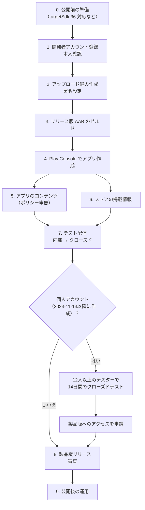
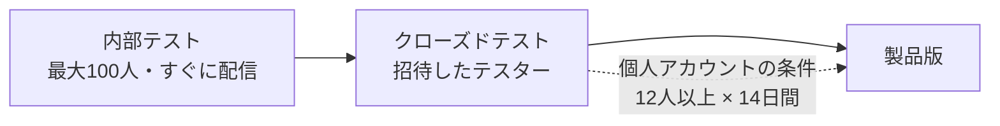

# Google Play ストア登録マニュアル

mp3player を Google Play に初めて公開するまでの手順。2026-10-19 時点の情報をもとにしている。

> Google Play の要件や Play Console の画面・項目名はよく変わる。各手順の前に、末尾の「参考資料」にある Google 公式ヘルプで最新の条件を確認すること。特に「開発者アカウント」と「テスト配信」の条件は、公式以外の情報源で確認した内容を含む。

## 全体の流れ



所要日数の目安は、本人確認に数日、組織アカウントの D-U-N-S 番号の取得に数日〜数週間、個人アカウントのクローズドテストに最低14日、審査に数日。初回の公開までは1か月程度を見込んでおく。

## 0. 公開前の準備（このアプリ固有）

2026-10-19 時点の状況。詳細は [stories.md](stories.md) と [tasks.md](tasks.md) の No.31〜36。

| 状態 | 項目 | 対応するストーリー |
| --- | --- | --- |
| ☑ | targetSdk・compileSdk を 36 にする（2026-08-31 以降、新規アプリと更新に必須） | No.31 |
| ☑ | Android Gradle Plugin の更新（8.13.2）、Gradle Wrapper の同梱 | No.32 |
| ☑ | Room のスキーマ管理と移行の仕組み（公開後のアップデートでデータを消さないため） | No.33 |
| ◐ | 署名付きリリースビルド、R8 による縮小（設定済み。正式なアップロード鍵の作成が残る） | No.34（本書の手順2〜3） |
| ☐ | Android 13 以降の実機での動作確認 | No.35 |
| ◐ | ストア素材・掲載文・プライバシーポリシーの公開 URL（素材と文面は [store/](store/) と [privacy-policy.md](privacy-policy.md) に作成済み。ページの公開が残る） | No.36（本書の手順5〜6） |

### 公開すると変えられないものを決めておく

- **パッケージ名（applicationId）**: 今は `com.mp3player.app`。**一度公開すると変更できず**、他のアプリに使われている名前は登録できない。自分が持っているドメインを逆にした名前（例: `io.github.<ユーザー名>.mp3player`）にするなら、最初のアップロードの前に変える。
- **アプリ名**: 今は `mp3player`（`app_name`）。ストアの表示名は後から変えられるが、検索で見つけてもらいやすく、他と区別できる名前を検討する。

## 1. 開発者アカウントの登録

1. Play Console（https://play.google.com/console ）に、公開に使う Google アカウントでログインする。個人の普段使いのアカウントとは分けることを推奨。
2. アカウントの種類を選ぶ。

| | 個人 | 組織 |
| --- | --- | --- |
| 本人確認 | 政府発行の身分証明書 | 組織の書類、D-U-N-S 番号、担当者の身分証明書、ウェブサイトの確認 |
| 製品版公開前のクローズドテスト | 必要（2023-11-13 以降に作成したアカウント） | 不要 |
| ストアに表示される開発者情報 | 氏名・国などが表示される場合がある | 組織名 |

3. 登録料（1回のみ。2026年時点で25米ドル、返金なし）を支払う。
4. 本人確認を完了する。確認が終わるまでアプリは公開できない。
5. 連絡先メールアドレス・電話番号を確認する。

## 2. アップロード鍵の作成と署名設定

Google Play では「Play アプリ署名」が必須。開発者は**アップロード鍵**で署名した AAB をアップロードし、利用者に配信されるアプリには Google が管理する**アプリ署名鍵**で署名される。アップロード鍵を無くしても、Play Console から再設定を申請できる。

### 鍵の作成

JDK の keytool で作る。保存場所はリポジトリの**外**にする。

```sh
keytool -genkeypair -v \
  -keystore C:/Users/<ユーザー名>/keys/mp3player-upload.jks \
  -alias upload \
  -keyalg RSA -keysize 2048 \
  -validity 10000
```

- パスワードと鍵ファイルは、パスワード管理ツールなど安全な場所にバックアップする。
- **鍵ファイルとパスワードは絶対にコミットしない。**

### Gradle の署名設定

プロジェクト直下に `keystore.properties` を作り（コミットしない）、`.gitignore` に追加する。

```properties
storeFile=C:/Users/<ユーザー名>/keys/mp3player-upload.jks
storePassword=********
keyAlias=upload
keyPassword=********
```

```gitignore
keystore.properties
*.jks
*.keystore
```

`app/build.gradle` には、ファイルがあるときだけ署名する次の設定を**追加済み**（CI など鍵が無い環境でもデバッグビルドは通る）。

```groovy
def keystorePropertiesFile = rootProject.file("keystore.properties")
def keystoreProperties = new Properties()
if (keystorePropertiesFile.exists()) {
    keystoreProperties.load(new FileInputStream(keystorePropertiesFile))
}

android {
    signingConfigs {
        release {
            if (keystorePropertiesFile.exists()) {
                storeFile file(keystoreProperties['storeFile'])
                storePassword keystoreProperties['storePassword']
                keyAlias keystoreProperties['keyAlias']
                keyPassword keystoreProperties['keyPassword']
            }
        }
    }
    buildTypes {
        release {
            minifyEnabled true
            shrinkResources true
            proguardFiles getDefaultProguardFile('proguard-android-optimize.txt'), 'proguard-rules.pro'
            signingConfig signingConfigs.release
        }
    }
}
```

CI でリリースビルドを作る場合は、鍵を Base64 にして GitHub の Secrets に入れ、ワークフロー内で復元する。

## 3. リリース版 AAB のビルド

1. `app/build.gradle` の `versionName`（利用者に見える版数、「メジャー.マイナー.パッチ」）と `versionCode` を上げる。`versionCode` は「メジャー×10000 + マイナー×100 + パッチ」（例: 1.0.0 → 10000、1.2.3 → 10203）。このルールは単体テスト `BuildConfigSpecTest` が検査する。
2. AAB をビルドする。

```sh
./gradlew bundleRelease
```

JDK 17 が必要（`gradle/gradle-daemon-jvm.properties` で指定）。

3. 出力: `app/build/outputs/bundle/release/app-release.aab`
4. **縮小（R8）を有効にした状態で必ず動作確認する。** AAB は端末に直接入れられないため、`bundletool` で APK に変換して入れるか、次の手順7の内部テストで配信して確認する。Glide・Room・Hilt・Media3 の主要な画面と再生を一通り試す。

## 4. Play Console でアプリを作成

「アプリを作成」から次を入力する。

| 項目 | 入力内容 |
| --- | --- |
| アプリ名 | ストアに表示される名前（30文字以内） |
| デフォルトの言語 | 日本語（ja-JP） |
| アプリかゲームか | アプリ |
| 無料か有料か | 無料（**後から有料にはできない**） |
| 申告 | デベロッパー プログラム ポリシーと米国輸出法への同意 |

作成後、ダッシュボードに「アプリをセットアップ」のチェックリストが表示されるので、その順に進める。

## 5. アプリのコンテンツ（ポリシー申告）

「ポリシー」→「アプリのコンテンツ」で申告する。このアプリでの回答案は次のとおり。実際の回答は、提出時点の実装に合わせて確認すること。

| 項目 | このアプリでの回答案 | 根拠・補足 |
| --- | --- | --- |
| プライバシーポリシー | 公開 URL を登録 | アプリ内の文面（`privacy_policy_body`）と同じ内容をウェブで公開する。GitHub Pages などが手軽 |
| 広告 | 含まない | 広告 SDK を使っていない |
| アプリのアクセス権 | すべての機能を制限なしで利用できる | ログインなどが無い |
| コンテンツのレーティング | アンケートに回答（ユーティリティ。暴力・性的表現・ユーザー間のやり取りなし） | 回答に応じてレーティングが付く |
| ターゲット ユーザー | 13歳以上を推奨 | 子ども向けに設定すると、ファミリー ポリシーへの追加対応が必要になる |
| データ セーフティ | 「データを収集・共有しない」 | 下記参照 |
| 政府機関・金融・健康・ニュースの各申告 | 該当しない | |
| フォアグラウンド サービスの権限 | メディア再生（mediaPlayback）の用途を説明 | バックグラウンド再生のために使用。動画での説明を求められる場合がある |

### データ セーフティの考え方

- このアプリは**インターネット権限を持たない**（ライブラリ由来のものを含めて、マージ後のマニフェストに `INTERNET` が無いことを確認済み）。外部への送信が起きないため、「収集」「共有」に当たるデータは無い。
- 再生履歴・お気に入り・プレイリストは端末内の DB にだけ保存する。録音はアプリ専用フォルダに保存し、外部に送らない。端末内だけで処理するデータは「収集」に含めなくてよい。
- 今後、クラッシュ収集や広告などの外部送信を伴う機能を入れたら、データ セーフティとプライバシーポリシーの両方を必ず更新する。

## 6. ストアの掲載情報

「拡大」→「メインのストアの掲載情報」で入力する。日本語に加えて、英語（en-US）の翻訳も追加する。

| 項目 | 要件 | このアプリでの準備 |
| --- | --- | --- |
| アプリ名 | 30文字以内 | |
| 簡単な説明 | 80文字以内 | 例: 「端末のMP3を再生。シャッフル・リピート、歌詞、イコライザー、録音にも対応」 |
| 詳しい説明 | 4,000文字以内 | 文面は [store/listing.md](store/listing.md) |
| アプリアイコン | 512×512 の PNG（32bit、1MB以内） | [store/icon-512.png](store/icon-512.png) |
| フィーチャー グラフィック | 1024×500 の JPEG または 24bit PNG（透過なし） | [store/feature-graphic-ja.jpg](store/feature-graphic-ja.jpg) / [-en.jpg](store/feature-graphic-en.jpg) |
| スクリーンショット | スマートフォン用を2〜8枚。長辺は短辺の2倍まで | [store/screenshots/](store/screenshots/)（日本語・英語各5枚、1388×2776） |
| アプリのカテゴリ | | 「音楽＆オーディオ」 |
| 連絡先 | メールアドレス（必須） | |

スクリーンショットはエミュレーターで撮れる（`adb exec-out screencap -p > screen.png`）。サンプル曲は自作の合成音源を使い、市販楽曲のタイトルやジャケットを写さないこと。

## 7. テスト配信



1. **内部テスト**: 「テスト」→「内部テスト」でリリースを作り、AAB をアップロードする。テスターのメールアドレスを登録し、配信された版で縮小済みビルドの動作を確認する。
2. **クローズドテスト**: テスターのリストを作り、オプトイン用のリンクを送る。
   - 2023-11-13 以降に作成した**個人アカウント**では、製品版の公開前に「**12人以上**のテスターが**14日間連続**でオプトインしたクローズドテスト」が必要（2024-12 に 20人から12人へ緩和）。テスターがいったん抜けると日数が数え直しになる場合がある。
   - 期間中はフィードバックを集め、不具合を修正した版を追加で配信しておくと、次の申請で説明しやすい。
3. **製品版へのアクセスを申請**: 条件を満たすとダッシュボードから申請できる。テストの内容やフィードバックへの対応についての質問に答える。審査は通常7日以内とされる。

## 8. 製品版リリース

1. 「製品版」→「新しいリリースを作成」で AAB を選ぶ（テストで使った版を昇格させてもよい）。
2. リリースノートを日本語・英語で書く（初回は「初回リリース」など）。
3. 公開する国・地域を選ぶ。
4. **段階的公開**（例: 20% → 50% → 100%）を使うと、不具合があったときの影響を小さくできる。
5. 審査に提出する。審査は数日かかることがあり、初回は長くなりやすい。結果はメールと Play Console で通知される。

審査で却下された場合は、通知に書かれたポリシー違反の箇所を直して再提出する。

## 9. 公開後の運用

- **クラッシュと ANR**: Play Console の「Android vitals」を定期的に確認する（No.42）。このアプリは外部のクラッシュ収集 SDK を使わない方針。
- **アップデート**: 毎回 `versionCode` を増やす。DB の構造を変える場合は、必ず Room の Migration を書いて移行テストを通す（No.33）。
- **対象 API レベル**: Google Play は毎年8月末ごろに求める targetSdk を引き上げる。期限までに対応しないと更新を提出できなくなる。
- **鍵の管理**: アップロード鍵のバックアップを定期的に確認する。
- **ポリシーの変更**: Play Console の受信トレイと登録メールに届くポリシー更新のお知らせを確認する。

## 提出前チェックリスト

- [x] targetSdk 36、compileSdk 36 でビルドできる
- [ ] パッケージ名を確定した
- [ ] `versionCode` を前回より増やした
- [x] R8 を有効にしたリリースビルドで主要機能が動く（エミュレータで確認。実機でも確認する）
- [ ] アップロード鍵とパスワードをバックアップした（コミットしていない）
- [ ] プライバシーポリシーを公開 URL に掲載した
- [ ] アプリのコンテンツの申告をすべて完了した
- [ ] ストアの掲載情報（日本語・英語）、アイコン、フィーチャー グラフィック、スクリーンショットを登録した
- [ ] 内部テストで動作を確認した
- [ ] （個人アカウントの場合）12人以上 × 14日間のクローズドテストを終えた

## 参考資料

Google 公式:

- [Target API level requirements for Google Play apps（Play Console ヘルプ）](https://support.google.com/googleplay/android-developer/answer/11926878)
- [App testing requirements for new personal developer accounts（Play Console ヘルプ）](https://support.google.com/googleplay/android-developer/answer/14151465)
- [Provide information for Google Play's Data safety section（Play Console ヘルプ）](https://support.google.com/googleplay/android-developer/answer/10787469)
- [Use Play App Signing（Play Console ヘルプ）](https://support.google.com/googleplay/android-developer/answer/9842756)
- [Sign your app（Android Developers）](https://developer.android.com/studio/publish/app-signing)

本書の作成時に参照したその他の情報（公式ではないため、公式ヘルプで要確認）:

- [Google Play's 12 Testers, 14 Days Requirement Explained](https://ontest.app/blog/google-play-12-testers-14-days-requirement-explained)
- [Google Play Developer Account: Cost, Types, and Setup (2026)](https://www.testerscommunity.com/blog/google-play-developer-account-guide)
- [Google Play Personal vs Organization Developer Account](https://12testerhive.com/blog/google-play-personal-vs-organization-developer-account)
