# 画面イメージ

アプリの各画面の構成と操作をまとめたもの。レイアウトは `app/src/main/res/layout/`、画面遷移は `res/navigation/nav_graph.xml` に対応する。
画面の図は要素の配置を示すラフなイメージで、実際の寸法・配色とは異なる。

> **図の表示について**
>
> - 画面遷移や動作の図は **Mermaid**。GitHub ではそのまま表示される。VS Code では Markdown Preview Mermaid Support などの拡張機能で表示できる。
> - 画面のワイヤーフレームは **PlantUML（Salt）**。GitHub では表示されないため、VS Code の PlantUML 拡張機能や Markdown Preview Enhanced、または PlantUML のサーバーで表示する。

## 画面遷移

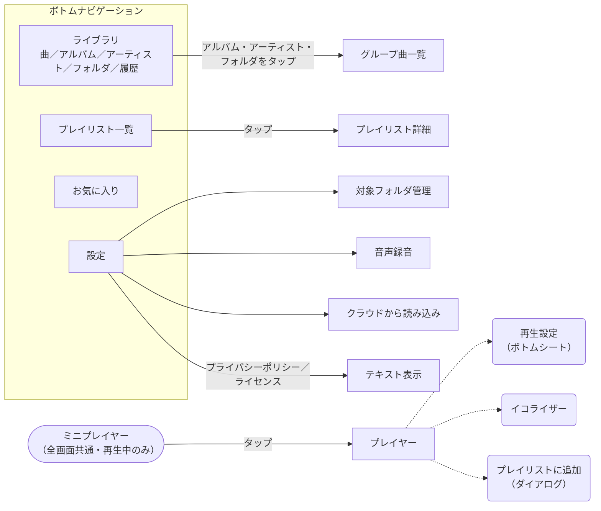

実線は画面の移動、点線はダイアログ・シートの表示。

## 共通レイアウト（MainActivity）

`activity_main.xml`。画面下部にミニプレイヤーとボトムナビゲーションを固定し、上部の領域で各画面を切り替える。

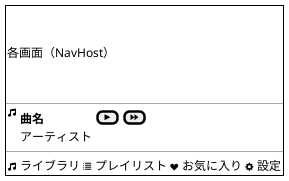

- **ミニプレイヤー**（`mini_player.xml`）
  - 再生する曲があるときだけ表示する。アルバムアート、曲名、アーティスト、再生/一時停止、次へを並べる。
  - 本体をタップするとプレイヤー画面を開く。
- **ボトムナビゲーション**（`menu/bottom_nav_menu.xml`）: ライブラリ／プレイリスト／お気に入り／設定の4タブ。

起動時の権限の確認:

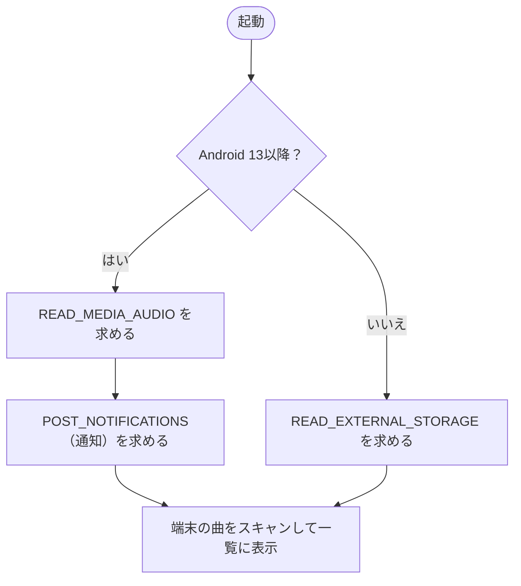

## ライブラリ

`fragment_library.xml`。上部に検索欄、表示切替ボタン、並び替えボタン、その下にタブとスワイプで切り替える一覧を置く。

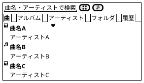

- **検索欄**: 曲名・アーティストで一覧を絞り込む。
- **表示切替**: 曲一覧をリスト表示とアイコン表示で切り替える。設定は保存され、曲タブ・グループ曲一覧・お気に入りで共通。
- **並び替え**（`menu/menu_sort.xml`）: 曲名順／アーティスト順／追加日順。
- **タブ**

| タブ | 内容 | タップしたとき |
| --- | --- | --- |
| 曲 | 全曲の一覧（`item_song.xml`）。アート・曲名・アーティストを表示し、お気に入りの曲には♥を付ける | その曲から再生する |
| アルバム | アルバムの一覧（`item_group.xml`）。タイトル＋補足（曲数など） | グループ曲一覧を開く |
| アーティスト | アーティストの一覧 | グループ曲一覧を開く |
| フォルダ | フォルダの一覧 | グループ曲一覧を開く |
| 履歴 | 「最近再生した曲」「再生回数が多い曲」の2セクション。ヘッダーのゴミ箱ボタンで確認ダイアログを出し、履歴を消去する | その曲から再生する |

- 曲を**長押し**すると、メニュー（お気に入り／プレイリストに追加／タグを編集）を出す。

### アイコン表示

`item_song_grid.xml`。画面幅に応じて2列以上（最小セル幅120dp）のグリッドにする。

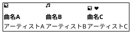

表示方法の切り替え:

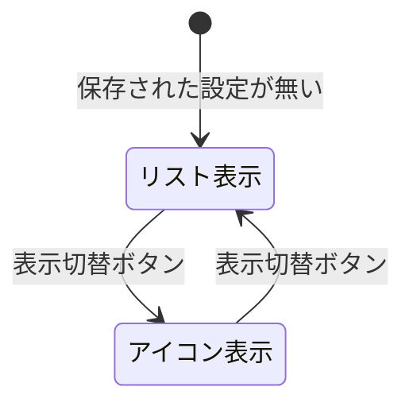

切り替えた結果は保存し、次回の起動時と他の曲一覧画面にも反映する。

### サムネイル

一覧・プレイヤー・ミニプレイヤー・プレイリスト詳細で、次の順に画像を探して表示する。

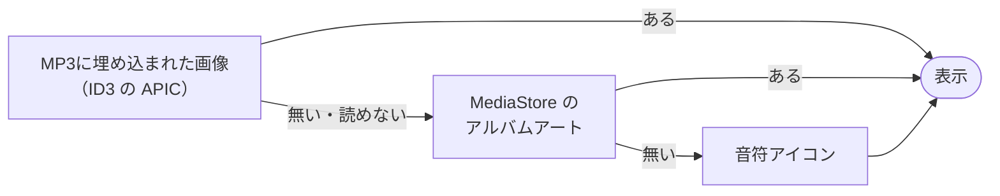

### タグ編集ダイアログ

`dialog_tag_edit.xml`。曲名・アーティスト・アルバムの3項目を入力欄で編集する。

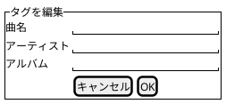

### グループ曲一覧

`fragment_song_list.xml` を使う。アルバム／アーティスト／フォルダに含まれる曲を並べる。

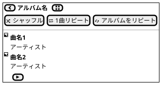

- **再生モードボタン**（横スクロール）: グループの全曲をキューにして、モードを指定して再生する。
- 右下の ▶（FAB）: 先頭からすべて再生する。

| ボタン | 再生のしかた |
| --- | --- |
| シャッフル | 全曲をランダムな順番で1回ずつ再生し、最後の曲で止まる |
| 1曲リピート | 先頭の曲から再生し、その曲を繰り返す |
| アルバム／フォルダ／アーティストをリピート | 先頭から順に再生し、最後まで行ったら先頭に戻る（ラベルは開いたグループの種類で変わる） |

- 曲をタップする通常の再生では、シャッフル状態を解除する。リピート設定はそのまま引き継ぐ。

再生モードボタンを押したときの処理:

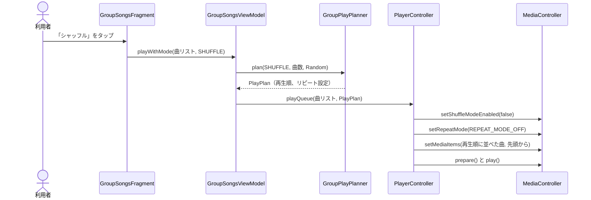

シャッフルはプレーヤーのシャッフル機能を使わず、`GroupPlayPlanner` が決めた再生順に曲を並べて渡す。プレーヤー側のシャッフルでは、開始位置より前にシャッフルされた曲が再生されないため。

## プレイヤー

`fragment_player.xml`。再生中の曲を全画面で表示し、操作する。

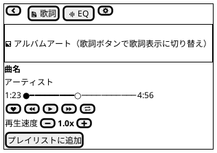

- **上部バー**: 戻る、歌詞、イコライザー、再生設定。
- **アート／歌詞**: 歌詞ボタンでアルバムアートと歌詞（LRC対応）の表示を切り替える。歌詞が無い場合は「歌詞が見つかりません」と出す。
- **シークバー**: 現在位置と曲の長さを表示し、ドラッグで再生位置を移動する。
- **操作ボタン**: お気に入り切替、前へ、再生/一時停止、次へ、リピートモード切替。
- **再生速度**: −／＋で0.1倍ずつ変える（0.5〜4.0倍）。数値をタップすると1.0倍に戻る。上限・下限では該当するボタンを押せなくなる。再生設定シートのスライダーと同じ値で連動する。
- **プレイリストに追加**: 追加先を選ぶダイアログを開く。

リピートボタンを押したときの切り替わり:

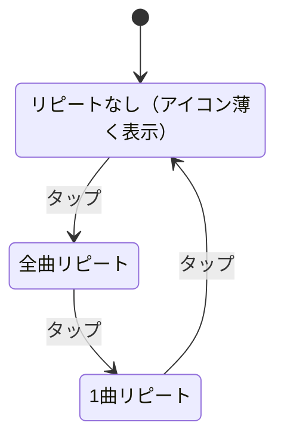

### 再生設定（ボトムシート）

`dialog_playback_settings.xml`。

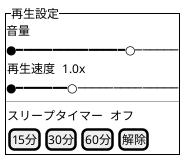

- 音量と再生速度をスライダーで変える。変更はすぐに反映する。
- スリープタイマー: 15／30／60分のチップで設定し、「解除」で止める。残り時間をステータス欄に表示する。

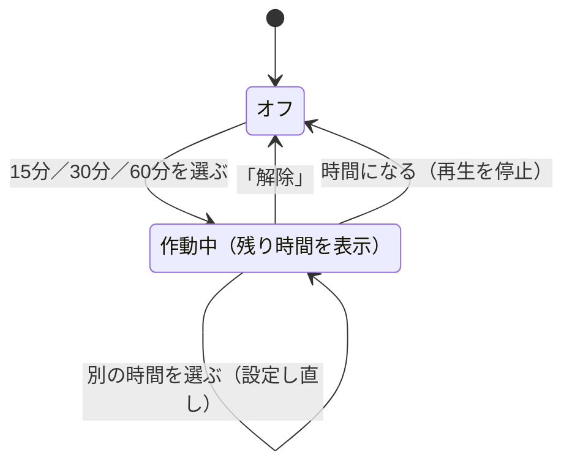

### イコライザー

`dialog_equalizer.xml`。

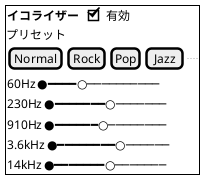

- スイッチで有効／無効を切り替える。
- プリセットは横スクロールのチップから選ぶ。名前と数は端末によって異なる。
- 帯域ごとのスライダーは端末のイコライザーが持つ帯域数だけ並べる。端末が対応していない場合は、利用できない旨のメッセージを出す。

### プレイリストに追加ダイアログ

`dialog_add_to_playlist.xml`。

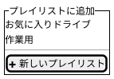

既存のプレイリストから追加先を選ぶ。「新しいプレイリスト」から、名前を入力して新規作成もできる。

## プレイリスト

### プレイリスト一覧

`fragment_playlist_list.xml`。

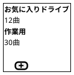

- タップするとプレイリスト詳細を開く。
- ＋ボタンで名前入力ダイアログを開き、新規作成する。
- プレイリストが1つも無い場合は「プレイリストがありません」と出す。

### プレイリスト詳細

`fragment_song_list.xml` を使う。

```plantuml
@startsalt
{+
  { [<&chevron-left>] | <b>プレイリスト名 | . | [<&menu>] }
  --
  {
    <&image> | <b>曲名1 | <&elevator> ドラッグで並べ替え
    <&image> | <b>曲名2 | <&arrow-thick-left> スワイプで削除
    <&image> | <b>曲名3 | .
  }
  { . | . | . | [<&media-play>] }
}
@endsalt
```

- 曲を上下にドラッグすると並べ替え、左右にスワイプするとプレイリストから外す。
- 右上のメニュー（`menu/menu_playlist_detail.xml`）: 名前を変更／削除。
- ▶ボタンでプレイリストを先頭から再生する。

## お気に入り

`fragment_song_list.xml` を使う。お気に入りに登録した曲を一覧にし、▶ボタンでまとめて再生する。登録が無い場合は「お気に入りの曲がありません」と出す。ヘッダーの表示切替ボタンでリスト／アイコン表示を切り替えられる。

## 設定

`fragment_settings.xml`。各行（`item_setting_row.xml`）はタイトルと補足（現在の設定値など）の2段。

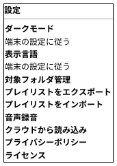

| 項目 | 動作 |
| --- | --- |
| ダークモード | ダイアログで「端末の設定に従う／ライト／ダーク」を選ぶ |
| 表示言語 | ダイアログで「端末の設定に従う／日本語／English」を選ぶ |
| 対象フォルダ管理 | 対象フォルダ管理画面を開く |
| プレイリストをエクスポート | プレイリストを選び、`.m3u8` ファイルとして保存する |
| プレイリストをインポート | `.m3u` / `.m3u8` ファイルを選んで取り込む |
| 音声録音 | 音声録音画面を開く |
| クラウドから読み込み | クラウド読み込み画面を開く |
| プライバシーポリシー／ライセンス | テキスト表示画面を開く |

### 対象フォルダ管理

`fragment_folder_filter.xml`。

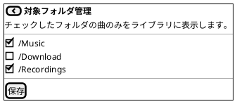

- チェックしたフォルダの曲だけをライブラリに表示する。何もチェックしなければ全フォルダが対象になる。

### 音声録音

`fragment_record.xml`。

```plantuml
@startsalt
{+
  { [<&chevron-left>] | <b>音声録音 }
  .
  { . | <b>00:00 | . }
  { . | [<&microphone> 録音開始] | . }
  --
  録音した音声
  { <&media-play> | {
      REC_20261018_193000.m4a
      0:42
    } }
}
@endsalt
```

```mermaid
stateDiagram-v2
    state "待機" as Idle
    state "マイクの権限を確認" as Check
    state "録音中（経過時間を表示）" as Recording
    [*] --> Idle
    Idle --> Check: 「録音開始」
    Check --> Recording: 許可あり
    Check --> Idle: 許可されなかった
    Recording --> Idle: 「録音停止」（REC_日時.m4a を保存し一覧に追加）
```

- 録音した音声はアプリ専用のフォルダに保存し、一覧のタップで再生する。

### クラウドから読み込み

`fragment_cloud_import.xml`。

```plantuml
@startsalt
{+
  { [<&chevron-left>] | <b>クラウドから読み込み }
  Googleドライブなどのクラウドストレージアプリから
  mp3ファイルを選択して取り込みます。
  [ファイルを選択]
  2件のファイルを取り込みました
}
@endsalt
```

「ファイルを選択」でシステムのファイル選択画面を開き、Googleドライブなどにあるmp3ファイルを選んで取り込む。取り込んだ件数を画面に表示する。

### テキスト表示

`fragment_static_text.xml`。プライバシーポリシーやライセンスなど、タイトルと本文をスクロールで表示する汎用画面。

## ホーム画面ウィジェット

`widget_player.xml`。

```plantuml
@startsalt
{+
  { <&musical-note> | {
      <b>曲名
      アーティスト
    } | [<&media-skip-backward>] | [<&media-play>] | [<&media-skip-forward>] }
}
@endsalt
```

- アルバムアート、曲名、アーティスト、前へ／再生・一時停止／次へを並べる。何も再生していないときはアプリ名を表示する。

## 通知・ロック画面

Media3の `MediaSession` による標準のメディア通知を使う。アプリ独自のレイアウトは持たない。アート、曲名、再生操作を通知欄とロック画面に表示し、Bluetoothや有線イヤホンのボタン操作にも対応する。

```mermaid
flowchart LR
    subgraph OUT["アプリの外からの操作"]
        N["通知・ロック画面"]
        W["ホーム画面ウィジェット"]
        B["Bluetooth／有線イヤホン"]
        A["Android Auto<br>（ブラウズ・音声検索）"]
    end
    N --> S["PlaybackService<br>（MediaLibraryService）"]
    W --> S
    B --> S
    A --> S
    S --> P["ExoPlayer"]
```
